# Implementación práctica de Snyk CLI: auditoría de seguridad de una aplicación web

**Alejandro Amador Ruiz**

Facultad de Ingenierías, Politécnico Colombiano Jaime Isaza Cadavid  
Diplomado en Ciberseguridad Informática y Resiliencia Digital  
2026-2

---

## Portada técnica

Este informe documenta la auditoría de seguridad de una aplicación web pequeña, hecha en Flask para fines de laboratorio. Los datos generales de la auditoría se resumen en la Tabla 1.

**Tabla 1**

*Datos generales de la auditoría*

| Campo | Detalle |
|---|---|
| Auditor | Alejandro Amador Ruiz |
| Docente | Edwin Andrés Ochoa Agudelo |
| Asignatura | Diplomado en Ciberseguridad, grupo 01, semestre 2026_02 |
| Actividad | Taller N.° 5: Implementación práctica de Snyk CLI |
| Repositorio | lab-ciberseguridad (Git local), rama de trabajo security-lab |
| Fecha | 2 de noviembre de 2026 |
| Sistema operativo | Windows 11 Pro |
| Herramientas | Snyk CLI 1.1308.3, Python 3.12.10, pytest 8.3.4, Node.js v26.13.0 |

## Resumen ejecutivo

Se revisó la seguridad de una aplicación web de notas hecha en Flask, creada a propósito con fallas para practicar. La revisión se hizo con Snyk CLI y siguió el ciclo que pide la actividad: detectar, analizar, priorizar, corregir, verificar y prevenir.

El primer análisis de dependencias (SCA) encontró 31 hallazgos: 9 altos, 20 medios y 2 bajos. El análisis del código propio (SAST) encontró 7: 6 altos y 1 bajo. De esos 38 hallazgos se eligieron tres: una inyección SQL (SAST), un grupo de dependencias vulnerables encabezado por Werkzeug (SCA) y un recorrido de rutas o path traversal (SAST).

Los tres se corrigieron y se comprobaron con un nuevo escaneo. Después de las correcciones, el SCA bajó de 31 a 2 hallazgos (ambos medios) y el SAST de 7 a 4, que corresponden a fallas que no estaban entre las tres elegidas. Las 7 pruebas automáticas pasaron, así que la aplicación siguió funcionando igual.

El hallazgo de mayor riesgo real fue la inyección SQL, y no coincide con el de mayor puntuación CVSS, que estaba en las dependencias. Esa diferencia es una de las ideas centrales del informe.

## Metodología y alcance

### Alcance

La auditoría se limitó al repositorio de laboratorio lab-ciberseguridad, creado para esta práctica. No se escaneó ni se probó ningún sistema de terceros. El escenario de explotación de cada falla se describe solo de forma conceptual y dentro del laboratorio. En este informe no aparece ningún token, contraseña ni credencial real.

### Fase 1: preparación y autenticación

Se creó la cuenta de Snyk, se instaló la CLI, se inició sesión con snyk auth y se comprobó con snyk whoami (Figura 1). También se activó Snyk Code en la configuración de la cuenta, porque sin eso no es posible hacer análisis SAST (Figura 2). Los datos del entorno aparecen en la Figura 3.

**Figura 1**

*Verificación de la sesión de Snyk con snyk whoami*

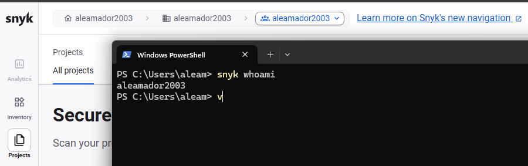

**Figura 2**

*Activación de Snyk Code en la configuración de la cuenta*

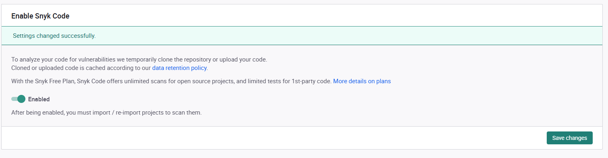

**Figura 3**

*Datos del entorno de trabajo*

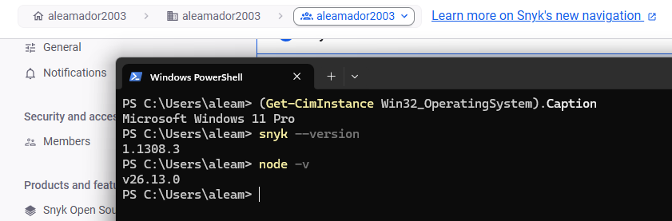

### Fase 2: análisis SCA

Se ejecutó snyk test sobre el archivo requirements.txt. Snyk revisó 11 dependencias, que son las cinco declaradas más las que estas traen consigo, y encontró 31 hallazgos en 54 rutas vulnerables (Figura 4). Por severidad fueron 0 críticos, 9 altos, 20 medios y 2 bajos (Figura 5).

**Figura 4**

*Resultado inicial de snyk test sobre requirements.txt*

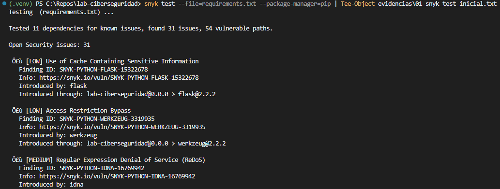

**Figura 5**

*Resumen del análisis SCA inicial*

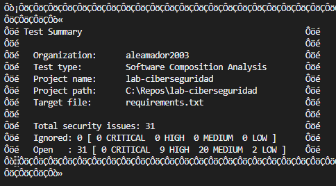

Para ver el detalle de los hallazgos altos (CVE, CVSS, versión segura y ruta de la dependencia) se usó el reporte en formato JSON que genera la misma herramienta. El resultado se resume en la Tabla 2.

**Tabla 2**

*Hallazgos de severidad alta del análisis SCA inicial*

| Paquete | Hallazgo | CVE | CWE | CVSS | Versión segura |
|---|---|---|---|---|---|
| urllib3 1.26.18 | Amplificación de datos por contenido muy comprimido | CVE-2026-21441 | CWE-409 | 8,9 | 2.6.3 |
| urllib3 1.26.18 | Inserción de información sensible en datos enviados | CVE-2026-44431 | CWE-201 | 8,2 | 2.7.0 |
| urllib3 1.26.18 | Amplificación de datos por contenido muy comprimido | CVE-2025-66471 | CWE-409 | 8,9 | 2.6.0 |
| urllib3 1.26.18 | Asignación de recursos sin límites | CVE-2025-66418 | CWE-770 | 8,9 | 2.6.0 |
| urllib3 1.26.18 | Asignación de recursos sin límites | CVE-2026-97689 | CWE-770 | 8,9 | 2.8.0 |
| urllib3 1.26.18 | Validación incorrecta de certificados | CVE-2026-97687 | CWE-295 | 7,6 | 2.8.0 |
| Werkzeug 2.2.2 | Denegación de servicio (DoS) | CVE-2023-25577 | CWE-770 | 7,5 | 2.2.3 |
| Werkzeug 2.2.2 | Ejecución remota de código (RCE) | CVE-2024-34069 | CWE-94 | 7,5 | 3.0.3 |
| Flask 2.2.2 | Exposición de información | CVE-2023-30861 | CWE-200 | 7,5 | 2.2.5 o 2.3.2 |

Nota. Datos tomados del reporte JSON de Snyk. Werkzeug y urllib3 aparecen como dependencias directas (declaradas en requirements.txt) y también como transitivas, a través de Flask y requests.

### Fase 3: análisis SAST

Se ejecutó snyk code test sobre el código propio. Reportó 7 hallazgos (Figura 6): 6 altos y 1 bajo (Figura 7). Los altos fueron dos inyecciones SQL (app.py, líneas 36 y 52), un recorrido de rutas (línea 70), un secreto escrito en el código (línea 13) y dos hallazgos sobre la línea 61, que son una inyección de plantillas y un XSS. El hallazgo bajo es una contraseña escrita en el archivo de pruebas.

**Figura 6**

*Resultado inicial de snyk code test*

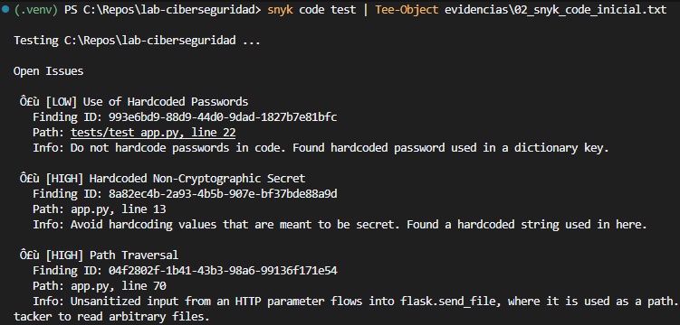

**Figura 7**

*Resumen del análisis SAST inicial*

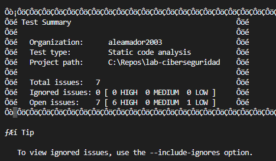

### Fase 4: selección de las tres vulnerabilidades

De los 38 hallazgos se eligieron tres, buscando cubrir SAST y SCA y tres categorías distintas del OWASP Top 10 de 2021 (OWASP Foundation, 2021): A03 Inyección, A06 Componentes vulnerables y desactualizados, y A01 Pérdida de control de acceso. El criterio fue escoger hallazgos con riesgo real y con una corrección que se pudiera comprobar con un nuevo escaneo.

## Matriz de vulnerabilidades

**Tabla 3**

*Matriz de las tres vulnerabilidades seleccionadas*

| # | Hallazgo | SAST/ SCA | CVE/CWE | Severidad | CVSS | Riesgo real | Estado |
|---|---|---|---|---|---|---|---|
| 1 | Inyección SQL en /login y /search | SAST | CWE-89 | Alta | No reportado | Alto | Corregido |
| 2 | Dependencias vulnerables: Werkzeug, Flask y urllib3 | SCA | CVE-2024-34069 / CWE-94 (principal) | Alta | 7,5 (principal) | Bajo a medio | Corregido |
| 3 | Recorrido de rutas en /download | SAST | CWE-22 | Alta | No reportado | Alto | Corregido |

Nota. Snyk Code no entrega puntuación CVSS para el código propio. El riesgo real se explica en cada ficha.

## Vulnerabilidad 1: inyección SQL (SAST)

### Ficha técnica y puntuación

**Tabla 4**

*Ficha técnica de la vulnerabilidad 1*

| Campo | Detalle |
|---|---|
| Nombre | Inyección SQL (SQL Injection) |
| Tipo | SAST |
| CWE | CWE-89 |
| OWASP Top 10 | A03:2021 Inyección |
| Severidad reportada | Alta (High) |
| CVSS | No disponible; Snyk Code no lo entrega para código propio |
| Ubicación | app.py, línea 36 (ruta /login) y línea 52 (ruta /search) |
| Versión vulnerable y segura | No aplica (es código propio) |

### Interpretación del riesgo

Como Snyk Code no da un CVSS, el riesgo se evaluó con otros criterios. Esto es coherente con que el CVSS mida la gravedad técnica de una falla pero no reemplace el análisis del contexto (FIRST, 2019). La falla se puede aprovechar por red, sin tener cuenta ni privilegios, escribiendo en los campos del formulario o en la dirección de búsqueda. El activo expuesto es la base de datos app.db, con las tablas de usuarios y notas.

Sobre la confidencialidad, el impacto es alto: se podría leer información de usuarios y notas, y en este laboratorio las contraseñas están guardadas sin cifrar. Sobre la integridad, es medio, porque permite entrar haciéndose pasar por otra persona, aunque las consultas afectadas son de lectura. Sobre la disponibilidad, es bajo. Para aprovecharla solo hace falta poder abrir la aplicación. En una empresa, esto significaría filtración de datos personales y pérdida de confianza. Snyk no reporta madurez de exploit para código propio, pero la inyección SQL es una técnica muy conocida y existen herramientas automáticas para usarla. En cuanto al alcance real (reachability), es total: las rutas son públicas y el dato del usuario llega directo a la consulta.

### Causa raíz

Es un defecto de implementación. La consulta SQL se armaba pegando el texto que escribe el usuario, así que la base de datos no podía distinguir entre datos y órdenes. Corresponde a CWE-89 (MITRE, s. f.) y a la categoría A03 del OWASP. El código vulnerable se ve en la Figura 8.

### Escenario de explotación

En el laboratorio, una persona que escriba en el campo de usuario un texto que cierre la comilla y deje una condición siempre verdadera lograría entrar sin conocer la contraseña. En la búsqueda podría ampliar la consulta para ver notas que no le corresponden. El daño sería acceso no autorizado y lectura de datos. No se hizo ninguna prueba contra sistemas externos.

### Código vulnerable (antes)

**Figura 8**

*Código vulnerable de las rutas /login y /search*

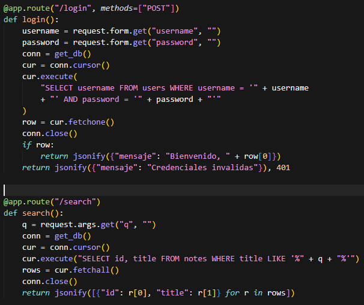

### Remediación aplicada

La estrategia fue usar consultas parametrizadas. El texto SQL queda fijo, con signos de interrogación donde van los datos, y los valores se envían por separado. Así lo que escribe el usuario siempre se trata como dato y nunca como parte de la orden. Con esto se corrige la causa raíz y no solo un síntoma. Se aplicó en las dos rutas y quedó registrado en un commit (Figura 10).

### Código corregido (después)

**Figura 9**

*Código corregido con consultas parametrizadas*

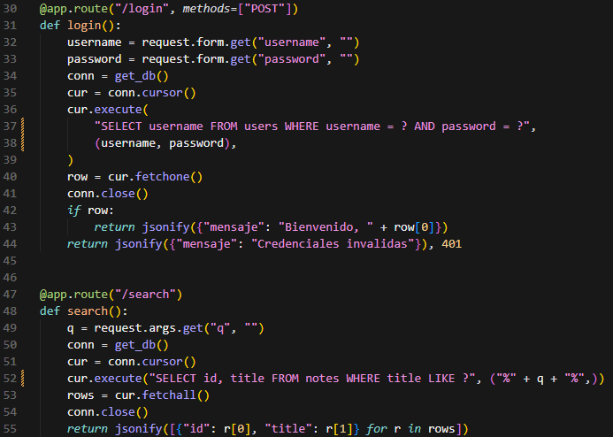

**Figura 10**

*Commit de la corrección de la inyección SQL*

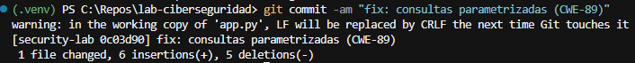

### Evidencia del reescaneo

En el nuevo análisis de código ya no aparece ningún hallazgo de inyección SQL (Figura 17). Las pruebas automáticas siguieron pasando (Figura 19), incluidos el login correcto, el login incorrecto y la búsqueda.

### Prevención y Shift-Left

Para que no se repita, se dejó una regla en el archivo .cursorrules que prohíbe armar consultas con texto del usuario, y el hook de pre-commit ejecuta Snyk Code antes de cada commit. En la integración continua, el mismo análisis se repite en cada push y cada pull request (ver la sección de controles preventivos).

## Vulnerabilidad 2: dependencias vulnerables (SCA)

### Ficha técnica y puntuación

**Tabla 5**

*Ficha técnica de la vulnerabilidad 2*

| Campo | Detalle |
|---|---|
| Nombre | Ejecución remota de código (RCE) en Werkzeug 2.2.2, dentro de un grupo de dependencias vulnerables |
| Tipo | SCA |
| CVE / CWE | CVE-2024-34069 / CWE-94 |
| OWASP Top 10 | A06:2021 Componentes vulnerables y desactualizados |
| Severidad reportada | Alta (High) |
| CVSS v3.1 | 7,5, vector CVSS:3.1/AV:N/AC:H/PR:N/UI:R/S:U/C:H/I:H/A:H |
| Dependencia | werkzeug 2.2.2, directa y también transitiva a través de flask 2.2.2 |
| Versión vulnerable y segura | 2.2.2 y 3.0.3 o superior (se instaló la 3.1.9) |
| Otros hallazgos del grupo | Flask 2.2.2 (CVE-2023-30861, 7,5) y urllib3 1.26.18 (seis hallazgos altos entre 7,6 y 8,9); ver la Tabla 2 |

### Interpretación de CVSS y riesgo

El vector dice que la falla se aprovecha por red (AV:N), con complejidad alta (AC:H), sin privilegios (PR:N), pero necesita que una persona haga algo (UI:R). Si se logra, el impacto es alto sobre confidencialidad, integridad y disponibilidad. Por eso la puntuación queda en 7,5 (FIRST, 2019). Snyk marca la madurez del exploit como no definida.

Aquí está lo importante: según el aviso del CVE, esta falla está en el depurador interactivo de Werkzeug. La aplicación de laboratorio no lo activa, porque no usa el modo debug y solo escucha en 127.0.0.1. Por eso, en la configuración actual el componente no es alcanzable y el riesgo real es bajo a medio, aunque el CVSS sea alto. El riesgo subiría si alguien activara el modo depuración. Con los demás hallazgos pasa algo parecido: urllib3 solo se usa en la ruta /status, con una dirección fija, y la falla de Flask necesita sesiones detrás de un proxy con caché, que no existe aquí.

### Causa raíz

Es un defecto de dependencia. El proyecto fijó versiones antiguas, publicadas antes de que se corrigieran estas fallas, y no tenía una política para revisarlas o actualizarlas. Corresponde a la categoría A06 del OWASP (OWASP Foundation, 2021) y, en el caso principal, a CWE-94, inyección de código.

### Escenario de explotación

Si la aplicación se ejecutara con el depurador activo, una persona podría engañar a un desarrollador para que visite una página maliciosa mientras el depurador está abierto, y así lograr ejecutar código en su máquina. En el caso de urllib3, un servidor malicioso que respondiera con datos muy comprimidos podría agotar la memoria de la aplicación y dejarla sin servicio. Ninguno de estos escenarios se probó.

### Dependencias vulnerables (antes) y corregidas (después)

La Tabla 6 muestra las versiones antes y después. Flask y Werkzeug se actualizaron juntos porque Flask 3 exige Werkzeug 3.

**Tabla 6**

*Versiones de las dependencias antes y después de la corrección*

| Paquete | Antes | Después |
|---|---|---|
| Flask | 2.2.2 | 3.1.3 |
| Werkzeug | 2.2.2 | 3.1.9 |
| Jinja2 | 3.1.2 | 3.1.6 |
| requests | 2.25.1 | 2.34.2 |
| urllib3 | 1.26.18 | 2.8.0 |

**Figura 11**

*Archivo requirements.txt actualizado e instalación de las nuevas versiones*

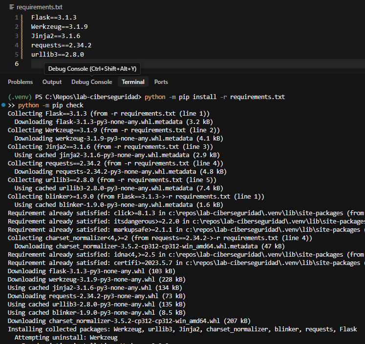

### Remediación aplicada

La estrategia fue actualizar los cinco paquetes a versiones sin hallazgos altos, reinstalar y volver a probar. Se descartó solo subir uno de ellos para no dejar versiones que no se llevan bien entre sí. El cambio quedó en un commit (Figura 12).

**Figura 12**

*Commit de la actualización de dependencias*

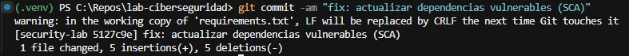

### Evidencia del reescaneo

Después de actualizar, el análisis pasó de 31 a 2 hallazgos, ambos de severidad media, y los 9 altos desaparecieron (Figura 18). Las 7 pruebas automáticas siguieron aprobadas (Figura 19), lo que indica que la actualización no rompió la funcionalidad. Los dos hallazgos que quedan se explican en la sección de hallazgos que permanecen.

### Prevención y Shift-Left

Como control, se agregó el archivo dependabot.yml, que revisa las dependencias cada semana, y el flujo de integración continua ejecuta snyk test con umbral alto. Además, quedó una lección: conviene fijar también las dependencias transitivas importantes, porque una de ellas (idna) fue la que dejó los dos hallazgos restantes.

## Vulnerabilidad 3: recorrido de rutas (SAST)

### Ficha técnica y puntuación

**Tabla 7**

*Ficha técnica de la vulnerabilidad 3*

| Campo | Detalle |
|---|---|
| Nombre | Recorrido de rutas (Path Traversal) |
| Tipo | SAST |
| CWE | CWE-22 |
| OWASP Top 10 | A01:2021 Pérdida de control de acceso |
| Severidad reportada | Alta (High) |
| CVSS | No disponible; Snyk Code no lo entrega para código propio |
| Ubicación | app.py, línea 70 (ruta /download, función send_file) |
| Versión vulnerable y segura | No aplica (es código propio) |

### Interpretación del riesgo

Según Snyk, un parámetro HTTP sin limpiar llega a la función send_file y se usa como ruta de archivo, lo que permitiría leer archivos arbitrarios. Se puede aprovechar por red y sin autenticación. El activo expuesto son los archivos del servidor: el código fuente, la base de datos app.db y un posible archivo .env. Sobre la confidencialidad el impacto es alto. Sobre la integridad y la disponibilidad es nulo o bajo, porque la falla solo permite leer. La condición para aprovecharla es poder abrir la ruta /download, que es pública. Para el negocio, significaría exponer datos de usuarios y el código de la aplicación, lo que además ayudaría a encontrar otras fallas. El alcance real es total.

### Causa raíz

Es un defecto de implementación. El nombre del archivo que manda el usuario se unía a la carpeta files con os.path.join sin comprobar que el resultado siguiera dentro de esa carpeta. Corresponde a CWE-22 (MITRE, s. f.) y a la categoría A01 del OWASP. El código vulnerable se ve en la Figura 13.

### Escenario de explotación

En el laboratorio, una persona podría pedir un nombre de archivo con secuencias para subir de carpeta y salirse de files, y así descargar el código de la aplicación o la base de datos. El daño sería la filtración de información. No se probó contra ningún sistema externo.

### Código vulnerable (antes)

**Figura 13**

*Código vulnerable de la ruta /download*

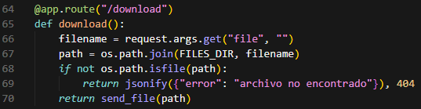

### Remediación aplicada

La estrategia fue validar la ruta con safe_join, una función de Werkzeug que devuelve vacío cuando el resultado se sale de la carpeta permitida. Si eso pasa, la ruta responde 404. Con esto se corrige la causa raíz, porque la comprobación se hace sobre la ruta final y no sobre el texto que escribió el usuario. Para usarla se agregó una importación (Figura 15) y se cambiaron dos líneas de la función. El cambio quedó en un commit (Figura 16).

### Código corregido (después)

**Figura 14**

*Código corregido de la ruta /download con safe_join*

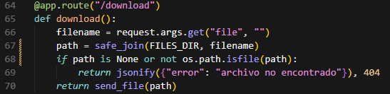

**Figura 15**

*Importación de safe_join*

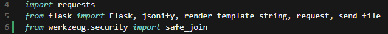

**Figura 16**

*Commit de la corrección del recorrido de rutas*

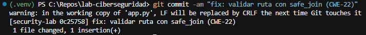

### Evidencia del reescaneo

En el nuevo análisis de código ya no aparece el hallazgo de recorrido de rutas (Figura 17). Las pruebas de descarga válida e inexistente siguieron pasando (Figura 19).

### Prevención y Shift-Left

La regla de .cursorrules indica no pasar datos del usuario a send_file ni a open sin validar con safe_join. Además, el hook y el flujo de integración continua repiten Snyk Code en cada cambio, de modo que una falla igual quedaría bloqueada antes de llegar a producción.

## Hallazgos que permanecen

Después de las correcciones quedaron 2 hallazgos de SCA y 4 de SAST. Ninguno estaba entre las tres vulnerabilidades elegidas. La Tabla 8 explica por qué permanecen. Cabe aclarar que las líneas cambiaron respecto al primer escaneo (el secreto pasó de la línea 13 a la 15 y la línea 61 a la 63) porque se agregaron líneas al archivo.

**Tabla 8**

*Hallazgos que permanecen después de las correcciones*

| Hallazgo | Ubicación | Sev. | Por qué permanece y qué se hará |
|---|---|---|---|
| ReDoS en idna 2.10 (SNYK-PYTHON-IDNA-16769942) | requests 2.34.2 > idna 2.10 | Media | idna no estaba fijada en requirements.txt. Al actualizar, pip conservó la versión 2.10 que ya estaba instalada y que cumple el rango que pide requests. Se corrige fijando una versión reciente de idna. La aplicación no procesa dominios escritos por usuarios, así que el riesgo es bajo. |
| Agotamiento de recursos en idna 2.10 (SNYK-PYTHON-IDNA-6597975) | requests 2.34.2 > idna 2.10 | Media | Mismo caso del anterior. |
| Secreto escrito en el código | app.py, línea 15 | Alta | Fuera de las tres elegidas. Se corrige leyéndolo de una variable de entorno. Es el caso que habría detectado un control de secret scanning. |
| Inyección de plantillas y XSS | app.py, línea 63 | Alta (2) | Fuera de las tres elegidas. Ambos vienen de la misma causa: concatenar el nombre dentro de render_template_string. Una sola corrección elimina los dos. |
| Contraseña escrita en el archivo de pruebas | tests/test_app.py, línea 22 | Baja | Es una credencial ficticia de laboratorio. Se acepta como falso positivo. |

## Comparación antes y después

**Tabla 9**

*Comparación de resultados antes y después de las correcciones*

| Medida | Antes | Después |
|---|---|---|
| Hallazgos SCA (total) | 31 | 2 |
| SCA de severidad alta | 9 | 0 |
| SCA de severidad media | 20 | 2 |
| SCA de severidad baja | 2 | 0 |
| Hallazgos SAST (total) | 7 | 4 |
| SAST de severidad alta | 6 | 3 |
| SAST de severidad baja | 1 | 1 |
| Inyección SQL | 2 | 0 |
| Recorrido de rutas | 1 | 0 |
| Pruebas pytest | No ejecutadas | 7 de 7 aprobadas |

Nota. Las pruebas pytest se ejecutaron una vez, al terminar las tres correcciones.

## Evidencias de reescaneo

Los análisis finales se muestran en las figuras siguientes. El de código quedó en 4 hallazgos y el de dependencias en 2. Las correcciones se hicieron en tres commits de la rama security-lab (Figura 20).

**Figura 17**

*Resumen del análisis SAST tras las correcciones*

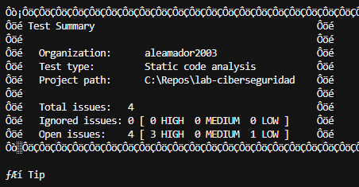

**Figura 18**

*Resumen del análisis SCA tras las correcciones*

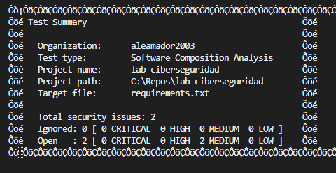

**Figura 19**

*Resultado de las pruebas automáticas con pytest*

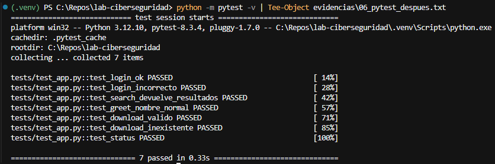

**Figura 20**

*Historial de commits de la rama security-lab*

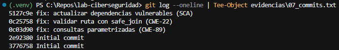

## Controles preventivos y Quality Gate

Además de corregir, se dejaron controles para que estas fallas no vuelvan a aparecer. La Tabla 10 los resume. Un Quality Gate es una regla que detiene el cambio cuando aparecen hallazgos de severidad alta. Aquí se implementó de dos formas: en el hook local y en el flujo de integración continua.

**Tabla 10**

*Controles preventivos del proyecto*

| Control | Qué hace | Estado |
|---|---|---|
| .cursorrules | Reglas para que la IA del editor no escriba código inseguro: consultas con parámetros, safe_join, secretos en variables de entorno y sin datos del usuario en render_template_string. | Implementado |
| Hook pre-commit | Ejecuta snyk code test con umbral alto antes de cada commit y lo bloquea si hay hallazgos altos. | Implementado |
| Flujo de GitHub Actions | En cada push y pull request ejecuta pytest, snyk test y snyk code test con umbral alto. Si hay hallazgos altos, el flujo falla (Quality Gate). El token de Snyk va como secreto del repositorio. | Implementado |
| Dependabot | Revisa las dependencias cada semana y propone actualizaciones. | Implementado |
| Bloqueo de pull request | Regla de protección de rama que exige que el flujo anterior pase antes de unir cambios. | Recomendado |
| Secret scanning | Herramienta que busca claves escritas en el código, por ejemplo gitleaks. | Recomendado |

Como prueba de que el hook funciona, se intentó un commit de prueba y quedó bloqueado, porque todavía existen tres hallazgos altos (Figura 21).

**Figura 21**

*Hook pre-commit bloqueando un commit con hallazgos altos*

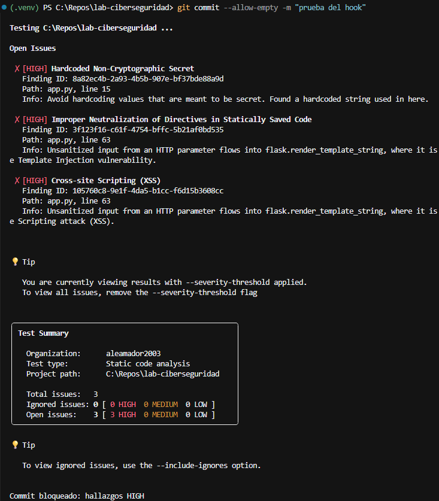

## Integración con Cursor y MCP

Cursor quedó configurado con el servidor MCP de Snyk, que aparece conectado con 14 herramientas habilitadas (Figura 22). Las correcciones de este laboratorio no se hicieron invocando esas herramientas. Se propusieron con ayuda de un asistente de IA conversacional (Claude, de Anthropic) y el auditor las revisó, las aplicó a mano y volvió a ejecutar Snyk y las pruebas.

La revisión humana consistió en leer el cambio de código, comprobar que la lógica siguió igual (login, búsqueda y descargas válidas e inválidas) y confirmar con el reescaneo. La IA propone, pero la decisión de aceptar cada cambio fue del auditor.

**Figura 22**

*Servidor MCP de Snyk conectado en Cursor*

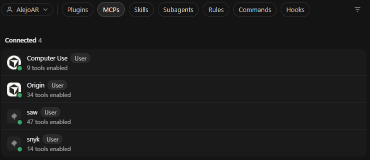

## Preguntas de cierre

### 1. ¿Cuál de las tres vulnerabilidades representa mayor riesgo real y por qué?

La inyección SQL. Está en rutas públicas, no pide autenticación, el dato del usuario llega directo a la consulta y permite entrar sin contraseña y leer información de la base de datos. El recorrido de rutas queda en segundo lugar, porque también permite leer archivos del servidor, incluida la base de datos. Las dependencias tienen las puntuaciones más altas, pero el menor riesgo real en esta configuración, porque la aplicación no activa el depurador y casi no usa la librería de red.

### 2. ¿La mayor puntuación CVSS siempre debe corregirse primero?

No. El CVSS mide la gravedad técnica, pero no sabe si la falla se puede alcanzar en una aplicación concreta (FIRST, 2019). Aquí, los hallazgos de urllib3 con 8,9 casi no se alcanzan, mientras que la inyección SQL, que Snyk Code ni siquiera puntúa, era la más urgente. Para priorizar hay que combinar la severidad con la exposición, la facilidad de explotación y el valor de lo que se protege.

### 3. ¿Qué diferencia hay entre vulnerabilidad identificada y vulnerabilidad explotable?

Una vulnerabilidad identificada es la que la herramienta encontró, por un patrón de código o por una versión con falla conocida. Una explotable, además, tiene un camino real para que alguien la use en esa aplicación: la ruta es accesible, la función afectada se usa y se cumplen las condiciones. Un ejemplo de este laboratorio es la ejecución remota de código de Werkzeug, que estaba identificada pero no era explotable sin el depurador.

### 4. ¿Qué impacto tiene sobre la tríada CID?

El impacto de cada una de las tres vulnerabilidades sobre confidencialidad, integridad y disponibilidad se resume en la Tabla 11.

**Tabla 11**

*Impacto de las vulnerabilidades sobre la tríada CID*

| Vulnerabilidad | Confidencialidad | Integridad | Disponibilidad |
|---|---|---|---|
| Inyección SQL | Alto | Medio | Bajo |
| Dependencias (caso principal: RCE en Werkzeug) | Alto, si se alcanza | Alto, si se alcanza | Alto, si se alcanza |
| Recorrido de rutas | Alto | Nulo | Nulo o bajo |

Nota. En las dependencias, el impacto depende de que se active el depurador. Los hallazgos de urllib3 afectan sobre todo la disponibilidad.

### 5. ¿Qué control habría detectado el problema antes de producción?

Snyk Code en el editor o en el pre-commit habría marcado la inyección SQL y el recorrido de rutas apenas se escribieron, y snyk test habría señalado las versiones viejas desde el primer commit. El hook de pre-commit lo demostró al bloquear el commit de prueba.

### 6. ¿Cómo llevaría ese control al CI/CD?

Con un flujo de GitHub Actions que, en cada push y pull request, instale las dependencias, ejecute pytest y corra snyk test y snyk code test con el umbral alto. Si hay hallazgos altos, el flujo falla y funciona como Quality Gate. El token de Snyk se guarda como secreto del repositorio y nunca en el código. Para bloquear el pull request se activa una regla de protección de rama que exija ese chequeo.

### 7. ¿Qué limitaciones observó en la automatización?

Snyk reportó 31 hallazgos en 54 rutas, con varios repetidos para una misma dependencia, y eso dificulta ver qué importa. Un mismo defecto puede dar dos hallazgos, como el XSS y la inyección de plantillas en la línea 63. Snyk Code no entrega CVSS para el código propio y marcó como falso positivo una contraseña ficticia de las pruebas. Una dependencia indirecta (idna) solo apareció en el reescaneo. Además, el plan gratuito limita las pruebas sobre código propio y la consola de Windows mostró caracteres extraños en los resultados. Y la herramienta solo detecta: no corrige.

### 8. ¿Qué parte requiere criterio humano?

Decidir qué se corrige primero, entender el contexto de la aplicación, separar los falsos positivos, comprobar que la corrección no cambie el comportamiento y decidir qué riesgos se aceptan por ahora y por qué. También hay que revisar lo que propone la IA antes de aceptarlo.

## Conclusiones

El laboratorio mostró que la seguridad de aplicaciones no se reduce a ejecutar un escáner. Los resultados de Snyk fueron el punto de partida, pero lo importante fue entender cada falla, decidir cuál era más urgente, corregirla y comprobar que la corrección funcionara y no rompiera nada.

Se corrigieron las tres vulnerabilidades elegidas. El SCA pasó de 31 a 2 hallazgos y el SAST de 7 a 4. Quedó claro que el CVSS no basta para priorizar: la inyección SQL, sin puntuación, fue más urgente que dependencias con 8,9.

Como trabajo pendiente quedan el secreto escrito en el código, el XSS con la inyección de plantillas, y fijar la versión de idna. También conviene activar el bloqueo de pull request y el secret scanning. Con los controles que ya existen (reglas, hook, integración continua y Dependabot), esas fallas se detectarían antes de llegar a producción.

## Referencias

FIRST. (2019). *Common Vulnerability Scoring System v3.1: Specification document*. https://www.first.org/cvss/v3.1/specification-document  
MITRE. (s. f.). *Common Weakness Enumeration (CWE)*. https://cwe.mitre.org/  
Ochoa Agudelo, E. A. (2026). *Implementación práctica: Snyk CLI* [Guía de taller]. Diplomado en Ciberseguridad, Politécnico Colombiano Jaime Isaza Cadavid.  
OWASP Foundation. (2021). *OWASP Top 10:2021*. https://owasp.org/Top10/  
Snyk. (s. f.). *Snyk documentation*. https://docs.snyk.io/  

## Anexos

Se incluyen dos evidencias adicionales: la estructura de archivos del repositorio (Figura 23) y los comandos usados en el reescaneo (Figura 24).

**Figura 23**

*Estructura de archivos del repositorio*

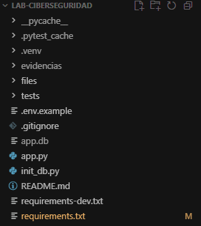

**Figura 24**

*Comandos del reescaneo*

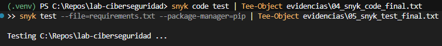
